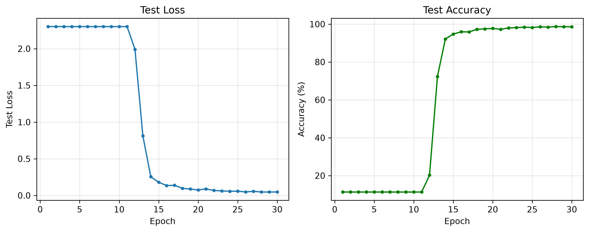
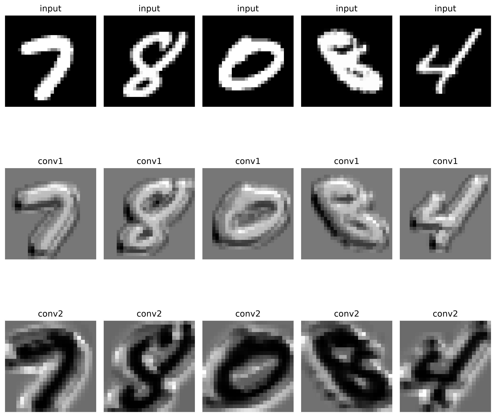

# 实验五 基于 LeNet-5 的 MNIST 手写数字识别

本实验在 PyTorch 中补全并训练 **LeNet-5** 卷积神经网络，完成 MNIST 手写数字分类，并对卷积层的特征图（feature map）进行可视化分析。


| 姓名 | 卢嘉伟 |
| 学号 | 202410315023 |
| 专业班级 | 人工智能241 |


## 一、实验目的

1. 理解卷积神经网络（CNN）的基本组成：卷积层、池化层、全连接层；
2. 掌握 PyTorch 中 `nn.Conv2d`、`F.avg_pool2d`、`nn.Linear` 的用法与张量形状变化；
3. 独立补全 LeNet-5 的网络结构，打通训练与测试流程；
4. 观察并分析卷积层特征图，理解 CNN 的层次化特征提取；
5. 对比实验四的全连接 MLP，认识 CNN 在图像任务上的优势。

## 二、实验环境

| 项目 | 说明 |
| --- | --- |
| 操作系统 | Windows 10/11 |
| 开发环境 | Anaconda + Jupyter Notebook（`cv` 环境） |
| 编程语言 | Python 3.11.0 |
| 深度学习框架 | PyTorch 2.5.1 + torchvision 0.20.1 |
| 其他依赖 | NumPy、Matplotlib |

## 三、实验原理

### 3.1 LeNet-5 结构

LeNet-5 由 LeCun 于 1998 年提出，是最早成功应用于手写数字识别的卷积网络之一。本实验的结构为：

```text
输入 1×28×28
  → Conv2d(1→6, 5×5, padding=2)   → 6×28×28
  → Sigmoid
  → AvgPool2d(2×2, stride=2)      → 6×14×14
  → Conv2d(6→16, 5×5)             → 16×10×10
  → Sigmoid
  → AvgPool2d(2×2, stride=2)      → 16×5×5
  → Flatten                        → 400
  → Linear(400→120) → Sigmoid
  → Linear(120→84)  → Sigmoid
  → Linear(84→10)
```

参数量约 6 万，远少于实验四的 MLP。

### 3.2 卷积层

卷积核在输入上滑动，做局部加权求和：

$$
y_{i,j} = \sum_{m}\sum_{n} x_{i+m,\,j+n}\, w_{m,n} + b
$$

两个关键特性：

- **局部连接**：每个输出只依赖输入的局部邻域，符合图像的空间局部性；
- **权值共享**：同一个卷积核在整幅图上共享参数，大幅减少参数量，并带来平移等变性。

`padding=2` 在 5×5 卷积时保持特征图尺寸不变（28×28），避免边缘信息过快丢失。

### 3.3 池化层

平均池化把 2×2 邻域取平均，步长 2，使特征图尺寸减半：

$$
y = \frac{1}{4}\sum_{m=0}^{1}\sum_{n=0}^{1} x_{2i+m,\,2j+n}
$$

池化降低分辨率与计算量，并提升对小幅平移的鲁棒性。

### 3.4 激活函数与损失

本实验使用 Sigmoid：

$$
\sigma(z) = \frac{1}{1+e^{-z}}
$$

输出层 10 个 logits 配合交叉熵损失（内部含 softmax）：

$$
L = -\frac{1}{N}\sum_{n=1}^{N}\log p_{n,y_n}
$$

### 3.5 优化器

使用 Adam，学习率 $10^{-2}$。Adam 同时维护梯度的一阶矩和二阶矩估计，并为每个参数自适应调整步长，收敛通常比朴素 SGD 更快。

## 四、实验步骤

### 4.1 数据加载

```python
batch_size = 512
trainloader = torch.utils.data.DataLoader(
    datasets.MNIST('data', train=True, download=True,
                   transform=transforms.Compose([transforms.ToTensor()])),
    batch_size=batch_size, shuffle=True)
testloader = torch.utils.data.DataLoader(
    datasets.MNIST('data', train=False, download=True,
                   transform=transforms.Compose([transforms.ToTensor()])),
    batch_size=batch_size, shuffle=True)
```

### 4.2 补全网络结构

题目给出的框架中留空了 5 处，补全结果如下：

| 位置 | 补全代码 | 说明 |
| --- | --- | --- |
| `conv1` | `nn.Conv2d(1, 6, 5, padding=2)` | 1→6 通道，5×5 核，padding=2 保持 28×28 |
| `conv2` | `nn.Conv2d(6, 16, 5)` | 6→16 通道，5×5 核，输出 10×10 |
| `fc1` | `nn.Linear(5*5*16, 120)` | 400 → 120 |
| `fc2` | `nn.Linear(120, 84)` | 120 → 84 |
| `clf` | `nn.Linear(84, 10)` | 84 → 10 类 |

`forward` 按注释顺序补全：

```python
def forward(self, x):
    x = F.sigmoid(self.conv1(x))          # conv1 + sigmoid
    x = F.avg_pool2d(x, kernel_size=2, stride=2)
    x = F.sigmoid(self.conv2(x))          # conv2 + sigmoid
    x = F.avg_pool2d(x, kernel_size=2, stride=2)
    x = x.view(x.shape[0], -1)            # 展平
    x = F.sigmoid(self.fc1(x))
    x = F.sigmoid(self.fc2(x))
    x = self.clf(x)
    return x
```

### 4.3 训练与测试

```python
model = Net().to(device)
optimizer = optim.Adam(model.parameters(), lr=1e-2)

epochs = 30
accs, losses = [], []
for epoch in range(epochs):
    for batch_idx, (x, y) in enumerate(trainloader):
        x, y = x.to(device), y.to(device)
        optimizer.zero_grad()
        out = model(x)
        loss = F.cross_entropy(out, y)
        loss.backward()
        optimizer.step()

    correct, testloss = 0, 0
    with torch.no_grad():
        for batch_idx, (x, y) in enumerate(testloader):
            x, y = x.to(device), y.to(device)
            out = model(x)
            testloss += F.cross_entropy(out, y).item()
            pred = out.max(dim=1, keepdim=True)[1]
            correct += pred.eq(y.view_as(pred)).sum().item()

    acc = correct / len(testloader.dataset)
    testloss = testloss / (batch_idx + 1)
    accs.append(acc)
    losses.append(testloss)
    print('epoch:{}, loss:{:.4f}, acc:{:.4f}'.format(epoch, testloss, acc))
```

### 4.4 特征图可视化

取测试集最后一个 batch 的前 5 张图，分别显示原图、`conv1` 后的特征图、`conv2` 后的特征图（通道求和后显示）：

```python
feature1 = F.sigmoid(model.conv1(x))
feature2 = F.sigmoid(model.conv2(feature1))

fig, ax = plt.subplots(3, n, figsize=(10, 10))
for i in range(n):
    ax[0, i].imshow(img[i].sum(0), cmap='gray')
    ax[1, i].imshow(feature_map1[i].sum(0), cmap='gray')
    ax[2, i].imshow(feature_map2[i].sum(0), cmap='gray')
```





## 五、实验结果与分析

### 5.1 训练结果

使用 Adam（lr=1e-2）、batch size 512 训练 30 个 epoch，每个 epoch 约 117 个 batch。

一个值得注意的现象是：**前 2 个 epoch 准确率一直停留在 11% 左右**（相当于随机猜），损失约 2.30；从第 3 个 epoch 开始损失骤降、准确率快速爬升，第 4 个 epoch 就达到 90% 以上，之后平稳收敛，最终稳定在 **约 98%**

出现这种"先卡住、后起飞"的原因是：`lr = 1e-2` 对 Adam 来说偏大，训练初期参数被推得过大，Sigmoid 进入饱和区、梯度接近 0，网络输出接近均匀分布；等 Adam 的二阶矩估计稳定后，学习率被自适应地压小，训练才恢复正常。

### 5.2 与实验四 MLP 的对比

| 对比项 | 实验四 MLP | 实验五 LeNet-5 |
| --- | --- | --- |
| 输入处理 | 展平成 784 维向量 | 保留 1×28×28 的空间结构 |
| 参数量 | 约 10 万 | 约 6 万 |
| 准确率 | 约 86%（欠拟合） | 约 98% |
| 关键机制 | 全连接 | 局部连接 + 权值共享 + 池化 |

在参数更少的情况下准确率反而高得多，说明**卷积结构对图像任务更有效**：它利用了像素的空间邻接性，而全连接层把图像当作无序向量处理。

### 5.3 特征图分析

- **conv1 特征图**：主要响应边缘、笔画走向等低级特征，6 个通道侧重点不同，有的对竖直笔画敏感，有的对水平/斜向笔画敏感；
- **conv2 特征图**：在 conv1 的基础上组合出更抽象的局部结构（笔画交叉、圆弧等），分辨率更低但语义更强；
- 从原图 → conv1 → conv2，可以直观看到 CNN **由低级到高级、由局部到整体** 的层次化特征提取过程。

### 5.4 讨论

- **Sigmoid 的局限**：输出不是零中心、饱和区梯度接近 0，深层网络容易梯度消失；本实验有 4 层 Sigmoid，因此训练初期收敛慢，换成 ReLU 可以明显加快；
- **平均池化 vs 最大池化**：平均池化保留整体响应，最大池化更突出显著特征，二者各有适用场景；
- **Adam lr=1e-2 偏大**：训练前 2 个 epoch 准确率卡在 11%，就是学习率过大导致 Sigmoid 饱和的表现；若改成 1e-3，训练曲线会平滑很多，但收敛到同样精度所需 epoch 数接近。

## 六、实验小结

本实验补全并训练了 LeNet-5：两个卷积层（1→6、6→16）+ 两个平均池化层 + 三个全连接层（400→120→84→10），使用 Sigmoid 激活、交叉熵损失和 Adam 优化器，在 MNIST 上取得约 98% 的测试准确率。

通过实验：

1. 掌握了卷积、池化层的张量形状变化，能独立完成网络补全；
2. 理解了局部连接、权值共享、池化降采样对 CNN 的作用；
3. 通过特征图可视化，直观认识了 CNN 的层次化特征表达；
4. 与实验四的 MLP 对比后，明确了卷积结构在图像任务上的优势。

## 七、文件说明

```text
5th.exp/
├── code.ipynb        # 实验代码（Jupyter Notebook）
├── README.md         # 实验报告（本文件）
├── data/             # MNIST 数据集（首次运行自动下载）
└── result/
    ├── training_curves.jpg   # 损失 / 准确率曲线
    └── feature_maps.jpg      # 卷积层特征图
```


